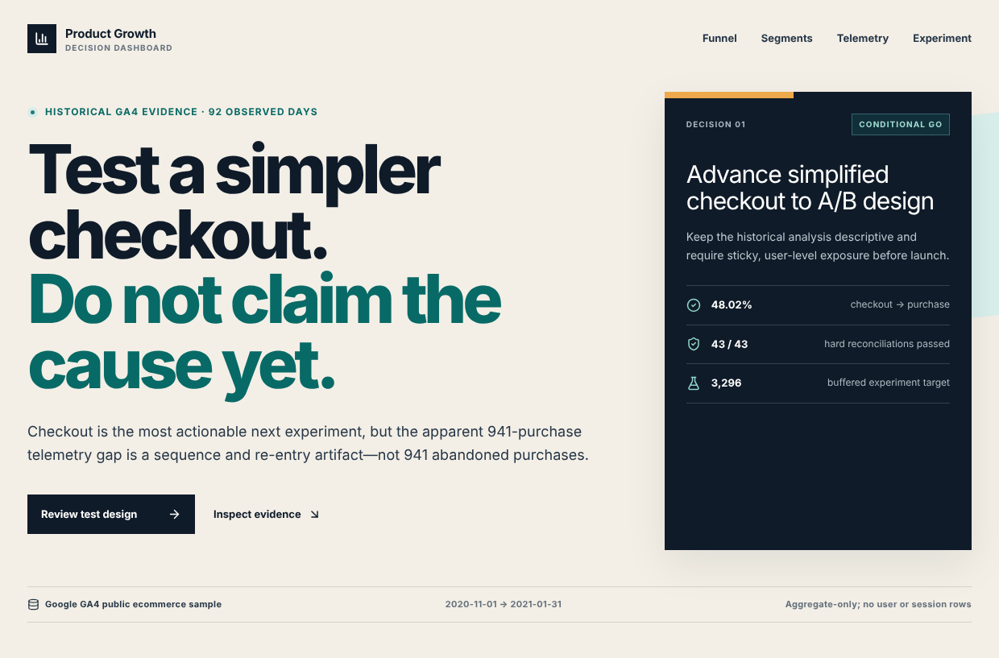
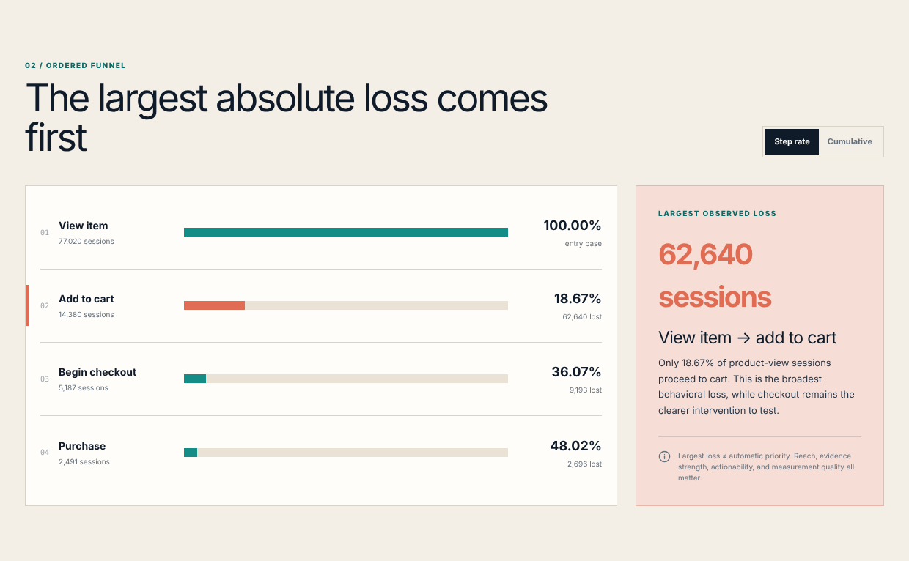
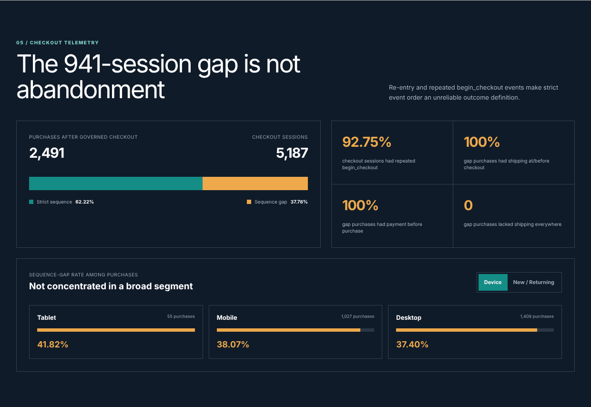

# Product Growth Analytics

**Where does an ecommerce funnel lose the most buyers, which fix should the
product team test first, and how large a test would prove it worked?**

An end-to-end case study on Google's public GA4 ecommerce sample: 4.3M events,
360K sessions, and 4,436 orders from Nov 2020 to Jan 2021, modeled in BigQuery
SQL, analyzed in Python, and delivered as an interactive dashboard and a
two-page decision memo.

**[Live dashboard](https://ga4-product-growth-decision-dashboard.world8866.chatgpt.site)** ·
**[Two-page decision memo (PDF)](docs/product_decision_memo.pdf)** ·
[Funnel analysis notebook](notebooks/01_funnel_and_sensitivity.ipynb) ·
[A/B test design notebook](notebooks/02_ab_test_design_and_simulation.ipynb) ·
[SQL models](sql/)

[](https://ga4-product-growth-decision-dashboard.world8866.chatgpt.site)

## Key findings

1. **The biggest leak is product page to cart.** 81% of sessions that view a
   product never add one to the cart: 62,640 lost sessions, about 7× the next
   largest drop.
2. **Missing checkout steps were re-entries, not abandonment.** 941 of 2,491
   purchases (38%) lack the full shipping-then-payment sequence after the
   checkout start the funnel counts, but all 941 had already logged shipping by
   then, and 93% of checkout sessions fire `begin_checkout` more than once. A
   strict step-sequence metric would have reported 30% checkout completion
   instead of the actual 48%.
3. **Returning visitors convert 4.4× better than new ones** (2.55% vs. 0.57%
   of sessions end in a purchase), while **mobile shows no deficit** against
   desktop (1.15% vs. 1.10%), so a mobile-only redesign is not supported.
4. **A naive revenue sum is overstated by 18%** ($362.2K vs. $306.7K of clean
   revenue), almost entirely from duplicated and conflicting transaction IDs;
   one ID appears on 883 purchase events. The models are guarded by 43
   automated reconciliation checks.
5. **Small improvements cannot be proven at this traffic.** Detecting a +5 pp
   checkout lift needs about 3,300 users (about 8 weeks); a +0.5 pp lift would
   need about 314,000 (about 15 years).

## Recommendation

Test a simplified checkout first, as a user-randomized A/B test with sticky
assignment. The product-page loss is larger, but it is spread across hundreds
of pages and its size swings with the benchmark chosen; checkout is a single,
measurable step with a larger scenario (+25.9 orders at a +0.5 pp lift,
against +21.5 for the best single product page). Historical data show where
users leave, not why, so only the experiment can establish cause. The design
is ready but not launch-ready: exposure logging, guardrails, and the minimum
worthwhile effect still need sign-off.

| Ordered funnel | Checkout telemetry |
|---|---|
|  |  |

## Skills demonstrated

- **SQL data modeling** on nested event data in BigQuery: staging, fact, and
  dimension models, window functions, `UNNEST`, and 43 reconciliation checks
  run from a Python command-line runner.
- **Product analytics:** ordered funnels, segment comparisons with Wilson
  intervals, weekly cohort retention, and benchmark-based opportunity sizing.
- **Experimentation:** sample size and MDE trade-offs, sample-ratio-mismatch
  checks, Newcombe intervals, guardrails, and a seeded simulation.
- **Communication:** an interactive dashboard and a two-page decision memo
  that keep observed behavior, scenarios, and causal claims separate.

The sections below give the full problem framing, method, and reproduction
steps.

## Business context

An ecommerce product manager is concerned that too few shopping sessions end in
a purchase. The team needs to know where users leave the journey and which
product experience should receive the next engineering and design investment.

The analysis follows the core journey:

```text
view_item → add_to_cart → begin_checkout → purchase
```

The project is deliberately framed as a decision case rather than a dashboard
exercise. It must connect event-level evidence to one prioritized product action
and an experiment that can validate the expected impact.

## Problem statement

Diagnose the largest meaningful source of purchase funnel loss, determine
whether that loss is concentrated in specific user segments or product
experiences, and recommend the page or funnel stage with the strongest
evidence-backed opportunity to increase completed orders.

The analysis must distinguish among three different claims:

1. **Observed behavior:** what happened in the historical GA4 sample.
2. **Opportunity estimate:** what might happen if an underperforming stage
   reached a defensible benchmark.
3. **Causal impact:** what can only be established through a randomized
   experiment.

Observational conversion gaps will not be presented as causal effects.

## Primary decision

> Which product page or funnel stage should the product team prioritize in the
> next iteration to maximize incremental completed orders, given opportunity
> size, uncertainty, and data quality?

The intended decision owner is the ecommerce product manager. Product design,
engineering, marketing, and analytics are supporting stakeholders.

## Decision criteria

A page or stage will be recommended only after evaluating:

- **Reach:** number of eligible sessions exposed to the stage.
- **Conversion gap:** difference from a relevant benchmark, not simply the
  lowest raw conversion rate.
- **Potential impact:** estimated incremental orders and revenue under an
  explicit improvement scenario.
- **Evidence strength:** denominator size, confidence interval, telemetry
  completeness, and consistency across segments.
- **Actionability:** whether the identified friction can be addressed by a
  specific product change and measured in an experiment.

The core opportunity estimate is:

```text
Potential incremental orders
= eligible sessions × max(0, benchmark conversion rate − observed conversion rate)
```

This is a scenario estimate, not a forecast or causal effect. Benchmarks will be
chosen within comparable contexts, such as the same product category or device
mix, whenever the data supports that comparison.

## Analytical questions

1. How many users and sessions reach each funnel stage?
2. Where is the largest absolute loss of eligible sessions?
3. Do funnel rates differ materially by device, acquisition channel, country,
   or new/returning status?
4. Which high-traffic products or product-detail experiences underperform a
   comparable benchmark?
5. How much revenue opportunity is associated with each candidate stage?
6. How does observed weekly return behavior differ across acquisition cohorts?
7. If checkout is selected for intervention, what sample size and minimum
   detectable effect are required for a simplified-checkout A/B test?

## Hypotheses to test

These are starting hypotheses, not conclusions:

- **H1 — Product detail friction:** a meaningful share of users view a product
  but do not add it to cart.
- **H2 — Cart or checkout friction:** users demonstrate purchase intent but
  leave before completing checkout.
- **H3 — Mobile friction:** mobile users have a lower stage-to-stage conversion
  rate than desktop users after accounting for traffic mix.
- **H4 — Acquisition quality:** conversion differences are partly explained by
  the source and medium that first acquired the user.
- **H5 — Familiarity:** returning users convert differently from genuinely new
  users.

A simplified checkout page is a candidate intervention. It will become the
primary recommendation only if the observed opportunity and evidence support
it. Otherwise, its A/B test remains a clearly separated experiment-design
exercise.

## Metric tree

```text
Revenue = Sessions × Orders per Session × Average Order Value

Orders per Session
└── diagnosed through the ordered product funnel:
    view_item → add_to_cart → begin_checkout → purchase

Future traffic and revenue
└── informed by observed weekly user retention
```

The detailed definitions, grains, exclusions, and caveats are maintained in the
[metric dictionary](docs/metric_dictionary.md).

## Scope

### Included

- BigQuery SQL for event profiling and reusable analytical tables.
- User, session, item, product, and order modeling.
- Ordered session funnel and step-level drop-off analysis.
- Device, acquisition, country, and user-tenure comparisons.
- Weekly cohort retention within the available observation window.
- An aggregate-only interactive web dashboard, with reusable CSV extracts for
  Tableau or Power BI.
- A user-randomized A/B test design with sample-size, MDE, confidence-interval,
  and sample-ratio-mismatch checks.
- Seeded synthetic experiment data that is visibly labeled as simulated.
- A two-page English product decision memo.

### Not included

- Claims about current Google Merchandise Store performance.
- Causal conclusions from historical segment differences.
- Customer lifetime value beyond the three-month observation window.
- Profit or margin analysis, because cost-of-goods data is unavailable.
- Live experimentation or changes to a real checkout.
- Publishing event-level rows or pseudonymous user identifiers to GitHub or
  a public dashboard.

## Data source and constraints

The source is Google's public
[GA4 ecommerce sample dataset](https://developers.google.com/analytics/bigquery/web-ecommerce-demo-dataset):

```text
bigquery-public-data.ga4_obfuscated_sample_ecommerce.events_*
```

The sample covers **2020-11-01 through 2021-01-31**. Google describes it as
obfuscated data that emulates a real implementation and warns that placeholder
values, nulls, and limited internal consistency may exist.

The raw export contains nested and repeated `event_params` and `items` records.
Event-level revenue and item-level analysis are therefore modeled separately to
avoid multiplying revenue when items are unnested. See the official
[GA4 BigQuery export schema](https://support.google.com/analytics/answer/7029846).

The first executable artifact is
[`sql/00_data_profile.sql`](sql/00_data_profile.sql), which checks coverage,
identifier quality, session parameters, ecommerce fields, page metadata,
segment dimensions, funnel ordering, and retention feasibility before any
business conclusion is written.

Observed profiling outputs and pass/fail interpretations are recorded in
[`docs/data_profile_results.md`](docs/data_profile_results.md).

## Deliverables

- Reproducible BigQuery SQL models and data-quality checks.
- Python notebooks for diagnostic analysis and experiment simulation.
- Interactive decision dashboard plus governed Tableau/Power BI-ready CSVs.
- English product decision memo in Markdown and PDF.
- Documentation covering data access, metric definitions, limitations, and
  reproduction steps.

## Repository structure

```text
.
├── README.md
├── requirements.txt
├── scripts/
│   ├── bq_runner.py
│   ├── build_analysis_notebook.py
│   ├── build_ab_test_notebook.py
│   ├── build_dashboard_data.py
│   └── build_decision_memo_pdf.py
├── sql/
│   ├── 00_data_profile.sql
│   ├── models/
│   ├── marts/
│   ├── qa/
│   ├── analysis/
│   └── README.md
├── notebooks/
│   ├── 01_funnel_and_sensitivity.ipynb
│   ├── 02_ab_test_design_and_simulation.ipynb
│   ├── figures/
│   └── README.md
├── dashboard/
│   ├── README.md
│   ├── field_dictionary.md
│   ├── aggregated_data/
│   ├── site/
│   └── screenshots/
├── docs/
│   ├── README.md
│   ├── analysis_layer_results.md
│   ├── data_model.md
│   ├── experiment_design.md
│   ├── metric_dictionary.md
│   ├── product_decision_memo.md
│   └── product_decision_memo.pdf
└── data/
    └── README.md
```

## Project log

The two open items need a live checkout and stakeholders, so they are out of
scope for a public-data case study.

<details>
<summary>All 37 work items, including each source-profiling check</summary>

- [x] Define the business problem and decision criteria.
- [x] Lock the first version of the metric dictionary.
- [x] Create the read-only source-data profiling queries.
- [x] Confirm complete source-table and event-date coverage (`00.1`).
- [x] Confirm daily completeness and retain diagnostic volume flags (`00.2`).
- [x] Confirm the required ecommerce event taxonomy (`00.3`).
- [x] Validate the composite session key and session-ID coverage (`00.6`).
- [x] Establish item-array coverage limits for product analysis (`00.9`).
- [x] Confirm purchase-field completeness and identify duplicate-order risk (`00.11`).
- [x] Quantify duplicate transactions and define conflict exclusions (`00.12`).
- [x] Lock the clean canonical order and revenue population (`00.12b`).
- [x] Establish the preliminary ordered session funnel (`00.10`).
- [x] Confirm page-level telemetry coverage (`00.15`).
- [x] Reject raw item arrays as a behavioral product funnel (`00.14`).
- [x] Reconcile canonical order revenue to purchase-item revenue (`00.13`).
- [x] Inventory event-parameter types and null payloads (`00.4`).
- [x] Validate critical event-parameter coverage (`00.5`).
- [x] Validate New and Returning session definitions (`00.8`).
- [x] Validate the acquisition-cohort retention population (`00.19`).
- [x] Validate device-segment availability (`00.16`).
- [x] Validate session-level country segmentation (`00.17`).
- [x] Profile first-observed acquisition quality (`00.18`).
- [x] Validate session-level channel attribution quality (`00.18b`).
- [x] Run the profile in BigQuery and record observed data-quality results.
- [x] Build and reconcile staging, core fact, and core dimension SQL.
- [x] Build funnel, segment, retention, opportunity, and dashboard marts.
- [x] Pass all 43 core and analysis-layer hard reconciliations.
- [x] Automate aggregate result extraction for dashboard and notebook inputs.
- [x] Complete funnel, segment, product, retention, and sensitivity analysis.
- [x] Select simplified checkout as the provisional experiment priority.
- [x] Build the sample-size, MDE, SRM, confidence-interval, and seeded simulation workflow.
- [x] Diagnose historical checkout sequence and repeated-event telemetry.
- [ ] Validate experiment exposure, guardrails, and current eligible-user throughput.
- [ ] Obtain stakeholder approval for the provisional MDE and guardrail margins.
- [x] Build and validate the aggregate-only interactive dashboard.
- [x] Build and validate the final two-page English decision memo.
- [x] Publish the repository update as a reviewable GitHub pull request.

</details>

All 19 core profile queries and both targeted follow-ups are recorded in
`docs/data_profile_results.md`. The implemented marts, thresholds, initial
evidence, and decision boundary are recorded in
[`docs/analysis_layer_results.md`](docs/analysis_layer_results.md). The next
phase validates experiment-specific instrumentation and current user-level
traffic before the planned test can be treated as launch-ready. The historical
sequence diagnosis is in
[`docs/checkout_telemetry_diagnostic.md`](docs/checkout_telemetry_diagnostic.md);
the planning contract is in
[`docs/experiment_design.md`](docs/experiment_design.md). The implemented
dashboard, download extracts, and reproduction commands are documented in
[`dashboard/README.md`](dashboard/README.md).

## Automated BigQuery workflow

The repository includes a local runner backed by the official Google Cloud
`bq` command. Credentials and project settings remain local and are ignored by
Git.

```bash
cp .env.example .env
# Set BQ_PROJECT_ID in .env.

make auth       # one-time browser authorization
make doctor     # verify tools, credentials, and configuration
make all        # build/refresh, require QA PASS, and export aggregates
make dry-run    # validate later SQL edits against the existing model graph
make build      # rebuild core views and refresh analysis tables
make qa         # require all 43 hard checks to pass
make extract    # save aggregate-only analysis CSVs locally

# One-time notebook environment setup; use Python 3.10 or newer.
make notebook-setup NOTEBOOK_PYTHON=/path/to/python3

make notebook      # execute the funnel/sensitivity notebook
make ab-notebook   # execute the A/B design/simulation notebook
make notebooks     # execute both from the latest complete aggregate export
make analysis      # make all, then execute both notebooks

make dashboard-setup  # one-time Node dependency install
make dashboard-data   # rebuild aggregate-only dashboard CSVs and site JSON
make dashboard-test   # build, reconcile, test, and lint the dashboard
make dashboard-dev    # run the local interactive dashboard

make memo             # rebuild and validate the two-page English memo PDF

make test             # offline Python regression tests; no BigQuery needed
```

Aggregate QA and analysis results are saved under
`data/interim/query_results/`. The runner never exports user-, session-, event-,
or order-level rows to the repository.

The successful analysis-layer run built all governed objects, passed 43 of 43
hard checks, and now exports twelve aggregate result sets. Recorded evidence is in
[`docs/model_build_results.md`](docs/model_build_results.md) and
[`docs/analysis_layer_results.md`](docs/analysis_layer_results.md). The executed
analysis artifact is
[`notebooks/01_funnel_and_sensitivity.ipynb`](notebooks/01_funnel_and_sensitivity.ipynb);
the explicitly simulated experiment artifact is
[`notebooks/02_ab_test_design_and_simulation.ipynb`](notebooks/02_ab_test_design_and_simulation.ipynb).
The dashboard builder selects the latest complete aggregate run and publishes
only governed summary rows under
[`dashboard/aggregated_data/`](dashboard/aggregated_data/).
